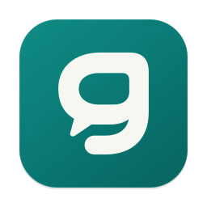

  

<h1 align="center">Gom</h1>

  <strong>Trò chuyện, gọn một nơi.</strong> 
  Các nền tảng quen thuộc và nhiều tài khoản, trong một cửa sổ trên Mac hoặc Windows.

  <a href="#tải-gom">Tải Gom</a> ·
  <a href="#cài-đặt">Cài đặt</a> ·
  <a href="#bắt-đầu-sử-dụng">Bắt đầu sử dụng</a> ·
  <a href="#câu-hỏi-thường-gặp">Câu hỏi thường gặp</a> ·
  <a href="https://github.com/mhfed/gom/issues">Báo lỗi</a>

Gom mở giao diện web của **Zalo, Telegram, Messenger, Gmail, Instagram, Discord, Slack và Tinder**. Bạn có thể thêm nhiều tài khoản cho cùng một nền tảng, đặt tên để phân biệt và chuyển qua lại bằng tab. Gom cũng hỗ trợ thêm website riêng.

## Tải Gom

Phiên bản hiện tại: **0.8.0**, phát hành ngày **29/10/2026** cho Mac Apple Silicon và Windows x64. Chọn bộ cài phù hợp với máy của bạn:

| Máy của bạn                                              | Yêu cầu                  | Tải xuống                                                                                                         |
| -------------------------------------------------------- | ------------------------ | ----------------------------------------------------------------------------------------------------------------- |
| Mac dùng chip Apple Silicon, như M1, M2, M3 hoặc mới hơn | macOS 13 trở lên · arm64 | [Tải Gom cho Mac (.dmg)](https://github.com/mhfed/gom/releases/download/v0.8.0/Gom-macOS-arm64-0.8.0.dmg)         |
| Máy tính Windows 64-bit                                  | Windows 10 hoặc 11 · x64 | [Tải Gom cho Windows (.exe)](https://github.com/mhfed/gom/releases/download/v0.8.0/Gom-win32-x64-0.8.0-Setup.exe) |

Bản Mac có thêm [gói ZIP](https://github.com/mhfed/gom/releases/download/v0.8.0/Gom-macOS-arm64-0.8.0.zip). Hiện chưa có gói dành cho Mac Intel hoặc Linux.

Xem [nội dung bản 0.8.0](https://github.com/mhfed/gom/releases/tag/v0.8.0) hoặc [tất cả phiên bản](https://github.com/mhfed/gom/releases).

Các tệp khác trên trang tải xuống dùng để làm gì?

- **`.dmg` hoặc `.exe`**: bộ cài bạn cần để bắt đầu sử dụng
- **`.zip`**: gói Gom.app cho Mac, dùng thay cho DMG nếu muốn
- **`.nupkg` và `RELEASES`**: các tệp phục vụ cập nhật Windows; bạn không cần mở chúng khi cài lần đầu
- **`SHA256SUMS-…txt`**: mã kiểm tra tính toàn vẹn của tệp tải về; đây không phải bộ cài hoặc chữ ký nhà phát hành

## Cài đặt

### Trên Mac

1. Tải và mở tệp **Gom-macOS-arm64-0.8.0.dmg**.
2. Kéo **Gom.app** vào **Applications**.
3. Đẩy ổ đĩa Gom ra bằng **Eject**, rồi mở Gom từ Applications.

Bản Mac hiện chưa có chữ ký Apple Developer ID và chưa được Apple notarize, nên macOS có thể chặn lần mở đầu tiên. Nếu bạn đã tải đúng từ GitHub của dự án, mở **System Settings → Privacy & Security → Open Anyway**, rồi xác nhận mở Gom. Xem [hướng dẫn của Apple](https://support.apple.com/en-us/102445).

DMG cũng kèm **Mo-Gom.command**. Sau khi kéo app vào Applications, bạn có thể dùng tệp này để gỡ cờ cách ly riêng của Gom rồi mở app. Chỉ chạy khi bạn tin cậy nguồn tải.

### Trên Windows

1. Tải **Gom-win32-x64-0.8.0-Setup.exe**.
2. Chạy tệp Setup và đợi quá trình cài đặt hoàn tất.
3. Mở **Gom** từ Start menu nếu app chưa tự mở.

Gom cài cho tài khoản Windows hiện tại, không yêu cầu quyền quản trị viên. Bản Windows chưa có chữ ký Authenticode nên SmartScreen có thể cảnh báo. Một số máy có thể chặn app bằng Smart App Control hoặc chính sách của tổ chức; xem [giải thích của Microsoft về Smart App Control](https://support.microsoft.com/en-us/windows/security/threat-malware-protection/smart-app-control-frequently-asked-questions).

## Bắt đầu sử dụng

Bạn thêm nền tảng và đăng nhập trực tiếp trong Gom:

1. Mở Gom, chọn **Mở nền tảng** trên màn chào mừng hoặc bấm nút **+** cạnh các tab.
2. Chọn nền tảng bạn muốn dùng.
3. Nếu Gom yêu cầu thêm tài khoản, đặt tên như **Cá nhân** hoặc **Công việc**, rồi chọn **Thêm tài khoản**.
4. Đăng nhập trên trang của nền tảng. Dùng mã QR nếu trang đăng nhập có hỗ trợ.
5. Muốn dùng thêm tài khoản, bấm nút **Thêm tài khoản** cạnh tên tài khoản đang chọn hoặc vào **Cài đặt → Tài khoản**.

Mỗi tài khoản có phiên đăng nhập riêng. Bấm tên tài khoản trên thanh công cụ để chuyển tài khoản trong cùng nền tảng. Bấm logo **Gom** để trở về màn chào mừng.

### Sắp xếp không gian của bạn

Bạn có thể tùy chỉnh cách các nền tảng xuất hiện:

- **Ghim tab**: nhấp chuột phải vào tab, chọn **Ghim tab** để thu gọn thành biểu tượng
- **Đóng tab**: chọn **Đóng tab** trong menu chuột phải; mở lại nền tảng từ nút **+** khi cần
- **Đổi logo**: nhấp chuột phải vào tab, chọn **Đổi logo**, chọn logo có sẵn hoặc tải ảnh PNG/JPG, rồi bấm **Lưu logo**
- **Thêm website**: bấm **+**, điền **Tên hiển thị** và **Địa chỉ website** trong mục **Thêm website riêng**
- **Đổi giao diện**: vào **Cài đặt → Giao diện** để chọn sáng, tối, theo hệ điều hành hoặc theo nền tảng

Logo mới áp dụng cho toàn bộ nền tảng đó và được lưu trên máy. Trong hộp đổi logo, chọn **Dùng logo mặc định** rồi **Lưu logo** để khôi phục.

Đóng tab giữ lại dữ liệu đăng nhập. Với website riêng, hãy lưu nội dung đang soạn trước khi đóng tab vì khả năng khôi phục bản nháp phụ thuộc website.

### Chat nổi và bong bóng

Mở tab muốn dùng, rồi bấm **Tách tab thành chat nổi** trên thanh công cụ. Gom chuyển nguyên trang đang dùng sang cửa sổ nhỏ, giữ phiên đăng nhập và bản nháp đang mở.

- Bấm **Thu gọn** hoặc **Escape** để thu thành bong bóng logo Gom ở góc màn hình; bấm bong bóng để mở lại.
- Kéo bong bóng để chuyển sang góc dưới trái hoặc phải. Kéo thanh tiêu đề/cạnh cửa sổ để di chuyển và đổi kích thước.
- Bấm **Ghim** để bật/tắt luôn nổi; bấm **Mở trong Gom** để đưa tab về cửa sổ chính.

Mỗi lúc có một tab nổi. Chat nổi thường tiếp tục hoạt động khi ẩn cửa sổ chính. Chat nổi kín và bong bóng được thu hồi khi không gian kín bị khóa. Xem [hướng dẫn Chat nổi](docs/floating-chat.md).

### Không gian kín

Gom có **Không gian thường** và **Không gian kín**, mỗi nơi có tài khoản, tab, tab ghim và tài khoản đang chọn riêng. Nhãn trên thanh công cụ cho biết bạn đang ở đâu.

Bấm **Không gian thường** cạnh biểu tượng ổ khóa để đặt mật khẩu (8–256 ký tự) hoặc nhập mật khẩu đã có. Gom chuyển sang **Không gian kín**; nếu chưa có tài khoản kín, không gian này bắt đầu trống. Bấm **Mở nền tảng** hoặc **Thêm tài khoản** để thêm và đăng nhập tài khoản riêng tại đây. Tài khoản thêm trong không gian kín tự thuộc không gian kín.

Bấm **Không gian kín** hoặc **⌘/Ctrl Shift L** để khóa và về không gian thường, khôi phục các tab và tài khoản đang dùng trước đó. Gom tự khóa khi ẩn/thu nhỏ cửa sổ, máy ngủ, màn hình khóa hoặc khởi động lại; chuyển sang ứng dụng khác không tự khóa.

Muốn chuyển tài khoản đang có, vào **Cài đặt → Tài khoản**, mở menu thao tác và chọn **Đưa vào không gian kín** hoặc **Chuyển sang không gian thường**. Khi chuyển vào, Gom yêu cầu mật khẩu. Bản 0.7.9 giữ nguyên mật khẩu, phiên đăng nhập và phân loại tài khoản đã có từ 0.7.8; tài khoản thường không tự chuyển vào không gian kín.

Tài khoản kín luôn tắt thông báo, kể cả lúc đang dùng, và đăng nhập trực tiếp trong Gom. Thông báo đã gửi trước khi chuyển vào không gian kín có thể còn trong lịch sử hệ điều hành. Phiên và bản nháp đang mở được giữ qua lần chuyển không gian.

Mật khẩu khóa truy cập qua giao diện Gom; **không mã hóa lại dữ liệu phiên trên đĩa**. Không có nút đặt lại mật khẩu làm hiện tài khoản kín khi quên mật khẩu. Xem [hướng dẫn Không gian kín](docs/private-space.md).

### Dùng phiên đăng nhập có sẵn trên Chrome

Nếu bạn đã đăng nhập trên Chrome ở cùng máy, mở **Cài đặt → Tài khoản → Dùng phiên có sẵn**. Chọn **Tài khoản đích**, chọn **Profile Chrome**, rồi bấm **Dùng phiên có sẵn**.

| Nền tảng                          | Cách kết nối từ Chrome                                                                                           |
| --------------------------------- | ---------------------------------------------------------------------------------------------------------------- |
| Zalo, Messenger, Instagram, Slack | Gom kiểm tra phiên trong profile bạn đã chọn và nhập khi định dạng được hỗ trợ                                   |
| Tinder                            | Làm theo hướng dẫn trong app để chạy lệnh một lần trong Console của tab Tinder đã đăng nhập; không cần extension |
| Gmail, Telegram, Discord          | Đăng nhập trực tiếp trong Gom                                                                                    |

Đây là thao tác nhập phiên một lần, không phải đồng bộ liên tục với Chrome. Trên Mac, hệ thống có thể hỏi quyền truy cập **Chrome Safe Storage**. Trên Windows, phiên được Chrome bảo vệ bằng **App-Bound Encryption (`v20`)** chưa nhập được; hãy đăng nhập trực tiếp trong Gom nếu gặp thông báo này.

Gom bảo vệ tài khoản đích đã đăng nhập khỏi ghi đè. Khi nền tảng yêu cầu xác minh hoặc phiên hết hạn, bạn cần hoàn tất đăng nhập lại.

## Thông báo và số chưa đọc

Để nhận thông báo, hãy kiểm tra quyền ở cả Gom, nền tảng và hệ điều hành:

1. Vào **Cài đặt → Thông báo**, cho phép thông báo với tài khoản bạn muốn nhận.
2. Bật thông báo trong trang của nền tảng nếu có tùy chọn này.
3. Cho phép Gom gửi thông báo trong cài đặt macOS hoặc Windows.
4. Kiểm tra chế độ **Tập trung / Không làm phiền** và mục tạm dừng thông báo trong Gom.

Nút **Gửi thử** kiểm tra thông báo từ Gom. Việc nhận thông báo tin nhắn còn phụ thuộc nền tảng có phát thông báo hay không.

Số trên tab dựa vào chỉ báo mà nền tảng cung cấp. Số có dấu **+** là số ước lượng hoặc số từ phần danh sách đã tải. Dấu **—** nghĩa là Gom chưa lấy được số đáng tin cậy, không có nghĩa là đã đọc hết. Website riêng chưa có bộ đếm chưa đọc.

## Cập nhật Gom

Mở **Cài đặt → Cập nhật → Kiểm tra cập nhật** để xem phiên bản mới:

- **Windows**: khi có bản tương thích, tải trong app và chọn khởi động lại để cài
- **Mac**: bản 0.8.0 mở trang tải xuống; tải DMG mới, thoát Gom, rồi kéo app vào Applications và chọn thay thế

Lưu hoặc sao chép bản nháp quan trọng trước khi thoát app để cập nhật. Gom dùng lại dữ liệu tài khoản đang có; việc duy trì đăng nhập và khôi phục bản nháp còn phụ thuộc từng nền tảng.

## Phím tắt

Các phím sau hoạt động trong Gom:

| Thao tác                       | Mac             | Windows            |
| ------------------------------ | --------------- | ------------------ |
| Tìm và chuyển nhanh tài khoản  | `⌘ K`           | `Ctrl K`           |
| Khóa không gian kín           | `⌘ Shift L`     | `Ctrl Shift L`     |
| Mở cài đặt                     | `⌘ ,`           | `Ctrl ,`           |
| Tải lại nền tảng đang mở       | `⌘ R`           | `Ctrl R`           |
| Quay lại trang trước           | `⌘ [`           | `Ctrl [`           |
| Thoát Gom                      | `⌘ Q`           | `Ctrl Q`           |
| Hiện / ẩn Gom từ ứng dụng khác | `⌘ Shift Space` | `Ctrl Shift Space` |

Phím tắt hiện / ẩn toàn cục cần được bật trong **Cài đặt → macOS / Windows**. Bạn cũng có thể bật **Chạy cùng macOS / Windows** tại đây.

Nút đóng cửa sổ chỉ ẩn Gom; app vẫn chạy nền. Mở lại từ Dock, Start menu hoặc biểu tượng Gom ở thanh menu / khay hệ thống. Để thoát hẳn, chọn **Thoát Gom** hoặc dùng phím tắt tương ứng.

## Câu hỏi thường gặp

Đóng tab hoặc gỡ tài khoản khỏi danh sách có đăng xuất không?

Đóng tab giữ dữ liệu đăng nhập. **Gỡ khỏi danh sách** trong phần Tài khoản cũng giữ dữ liệu phiên trên máy; dùng **Khôi phục** để đưa tài khoản trở lại. Nội dung chưa gửi có thể mất khi trang đóng, tùy nền tảng.

Vì sao Chrome đã đăng nhập nhưng Gom vẫn yêu cầu đăng nhập?

Gom có phiên riêng với Chrome. Bạn cần đăng nhập trực tiếp hoặc dùng **Dùng phiên có sẵn** với đúng tài khoản đích và profile Chrome. Một số định dạng phiên chưa được hỗ trợ; nền tảng cũng có thể yêu cầu xác minh lại.

Muốn sao chép ảnh, văn bản hoặc liên kết thì làm thế nào?

Nhấp chuột phải vào nội dung và chọn mục phù hợp như **Sao chép**, **Sao chép ảnh**, **Sao chép liên kết** hoặc **Lưu ảnh thành…**. Các mục xuất hiện tùy nội dung bạn đang chọn và cách trang web hiển thị nội dung đó.

Website riêng không đăng nhập được hoặc mở liên kết ra trình duyệt?

Một số website chuyển sang tên miền khác trong quá trình đăng nhập hoặc chặn trình duyệt nhúng. Thử đăng nhập trực tiếp trong Gom. Nếu vẫn lỗi, dùng trình duyệt cho website đó và gửi báo lỗi kèm địa chỉ trang, không gửi dữ liệu đăng nhập.

Tài khoản có đồng bộ sang máy khác không?

Gom lưu phiên đăng nhập và tùy chỉnh cục bộ trên từng máy. Khi chuyển máy, hãy cài Gom và đăng nhập lại các tài khoản. Việc đồng bộ tin nhắn do chính nền tảng thực hiện.

## Báo lỗi và góp ý

[Tạo báo lỗi trên GitHub Issues](https://github.com/mhfed/gom/issues/new) và ghi rõ phiên bản Gom, hệ điều hành, nền tảng gặp lỗi cùng các bước để tái hiện. Nếu gửi ảnh chụp, che nội dung riêng tư trước khi tải lên.

Không gửi mật khẩu, mã OTP, cookie, token hoặc toàn bộ hồ sơ trình duyệt.

Gom là ứng dụng độc lập, không thuộc các nền tảng được tích hợp. Giao diện, khả năng đăng nhập và thông báo có thể thay đổi theo chính sách của từng dịch vụ.
